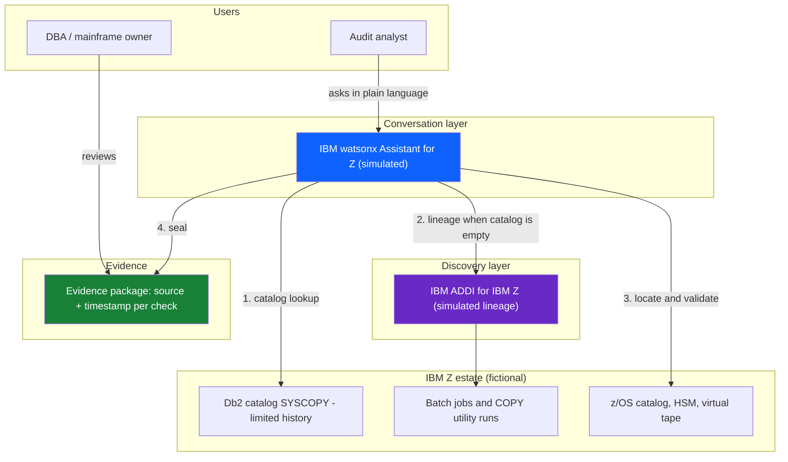

# Architecture

Illustrative demo built with IBM Bob — uses synthetic data.

## Solution summary

A static, mock-only React app that shows the target flow for answering an audit question about an old Db2 backup: **IBM watsonx Assistant for Z** takes the question, **IBM Application Discovery and Delivery Intelligence (ADDI) for IBM Z** supplies job and program lineage when the Db2 catalog has no history, the backup is located and validated, and an evidence package records every check. Both IBM products are **simulated screens**. There is no REST API, no backend and no watsonx.ai.

In plain terms, one request is five steps (this is also what the app's Architecture page shows):

1. **Ask:** the audit analyst asks in plain language (watsonx Assistant for Z, simulated).
2. **Check the catalog:** Db2 SYSCOPY has no row, because history is limited (synthetic data).
3. **Find the lineage:** ADDI shows which batch job and program wrote the backup (simulated).
4. **Locate and validate:** the dataset is found in z/OS catalog, HSM or tape, and checked (synthetic data).
5. **Seal the evidence:** every check is recorded with its source system and time (built).

What is deployed today: the web app and the evidence export only. Nothing connects to a bank system.

Component diagram (for engineers):

## Component inventory

| Component | Role | Status in this demo |
|---|---|---|
| Carbon React UI (Carbon v11, g90) | Dashboard, scenario runner, chat, evidence panel | Built, static |
| IBM watsonx Assistant for Z | Conversational entry point | Simulated: scripted messages |
| IBM ADDI for IBM Z | Job to program to Db2 object lineage | Simulated: precomputed fictional output |
| Db2 catalog, z/OS catalog, HSM, tape | Where evidence would be read | Synthetic data, 222 records, seed 42 |
| Evidence package | Per-check source, timestamp, outcome | Built, client-side JSON export |
| REST APIs, watsonx.ai | Out of scope | Not used |

## Data flow (in the demo)

1. `scripts/generate-data.mjs` writes `data/backups.json` (seed 42).
2. `src/data/scenarios.js` derives, per preset scenario, seven timed checks and the outcome (validated or gap).
3. `SolutionPage` replays the checks in order, driving the chat, the check list, the simulated clock and the evidence panel.
4. `scripts/record-video.mjs` drives the built app in headless Chrome and records a silent WebM with caption notes. With `--narrate` it also synthesizes the voice with the offline Windows voice (`scripts/synth-voice.ps1`) and muxes it with ffmpeg into an H.264/AAC MP4.

## Integration points (for a pilot, not built here)

- ADDI project and its Db2 instance: real lineage queries.
- Db2 for z/OS catalog and image copy records: real SYSCOPY and housekeeping policy.
- z/OS catalog, HSM, tape management: real dataset location.
- watsonx Assistant for Z: confirm deployment requirements with the product team (verify before presenting).

## Security architecture

Static site, no credentials, no network calls at runtime, no cookies, no user input sent anywhere. No `eval` or `dangerouslySetInnerHTML`.

## Deployment architecture

GitHub Pages from `AMEQUI/db2-backup-traceability-demo` through `.github/workflows/pages.yml`. Vite `base: './'` and `HashRouter` keep it working under a sub-path. No container is required (DEPLOY_TARGET: local / static hosting), so no Dockerfile or UBI image applies.

## Non-functional notes

- Accessibility: Carbon components, skip link, ARIA labels on timer, log and lists, keyboard-operable scenario buttons.
- Reproducibility: fixed seed and fixed as-of date.
- Not measured: performance figures and the 15-minute target are illustrative.

## IBM product versions

Not applicable: no IBM product is installed or called. Versions are to be confirmed in a pilot.
