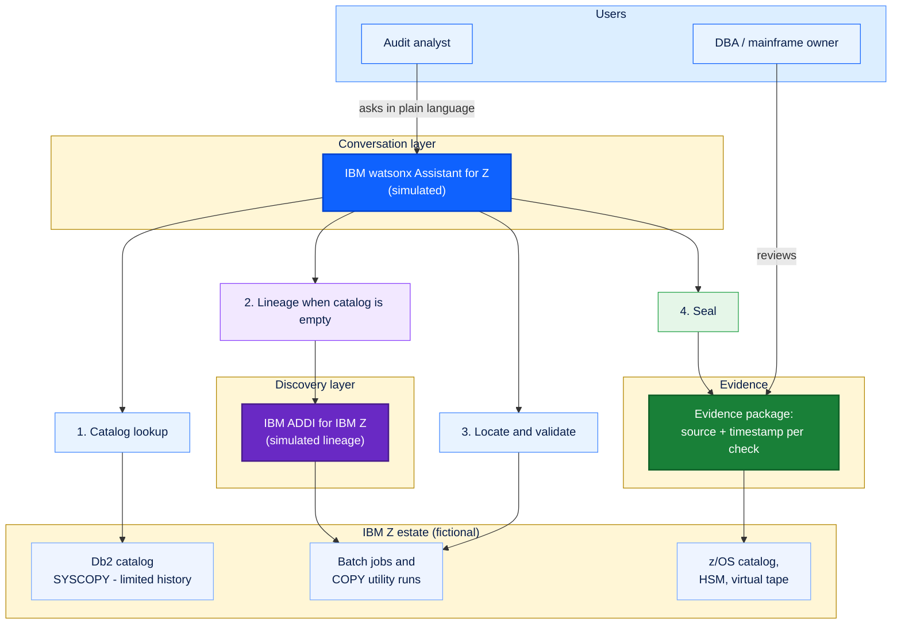

# IBM Z Backup Discovery and Evidence Flow

This diagram presents the simulated flow used to locate, validate, and document historical backup evidence across an IBM Z environment.

> **Demo note:** The environment and data are fictional. IBM watsonx Assistant for Z and IBM ADDI for IBM Z are represented as simulated components.

## Flow summary

1. The **audit analyst** asks a question in plain language.
2. The simulated conversation layer directs the request through catalog lookup, lineage discovery, location and validation, and evidence sealing.
3. **IBM ADDI for IBM Z** represents simulated lineage discovery when catalog history is insufficient.
4. The evidence package records the source and timestamp for each check.
5. The **DBA / mainframe owner** reviews the resulting evidence.

## GitHub rendering

GitHub renders Mermaid diagrams directly in Markdown files. If the diagram does not appear, confirm that:

- The file uses the `.md` extension.
- The code block begins with `mermaid` exactly as shown.
- GitHub Enterprise Server is on a version that supports Mermaid diagrams.
